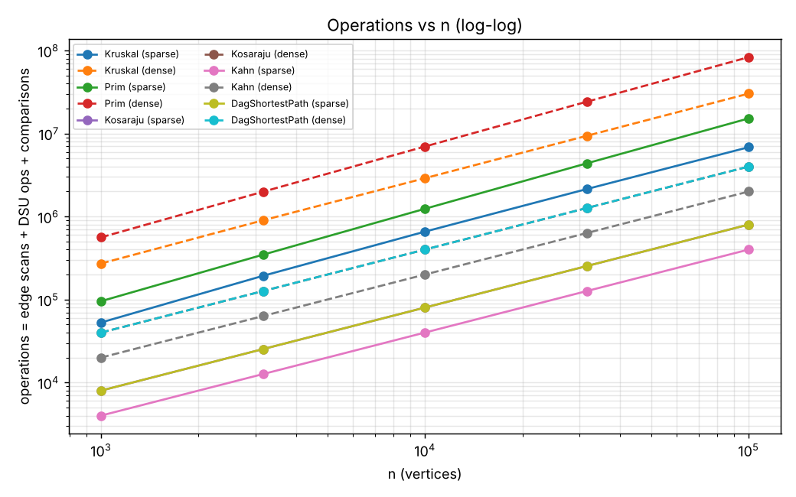
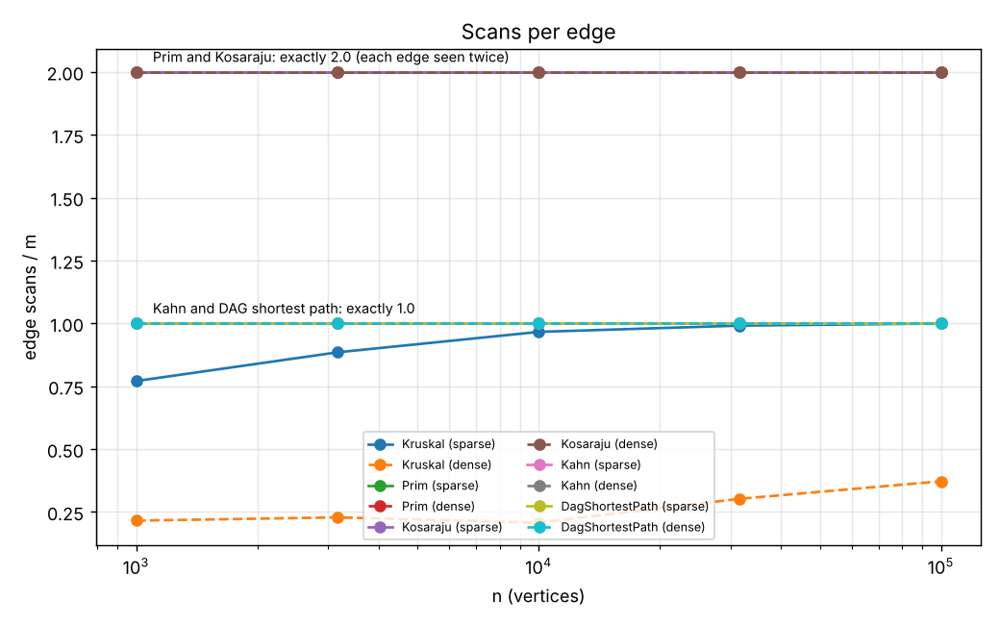
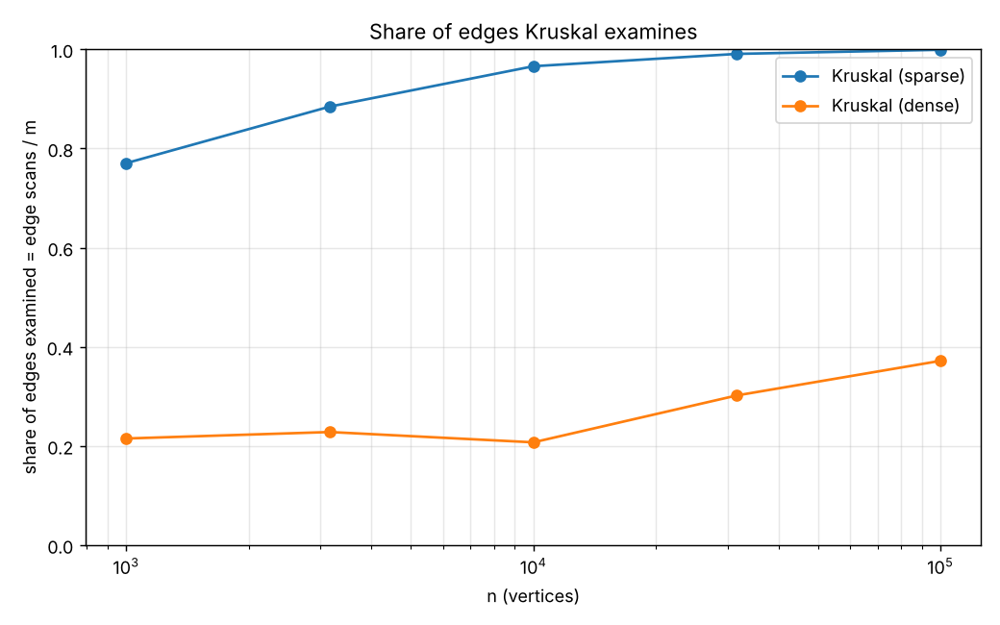

# Assignment 3 Report — Graphs: DSU, MST, SCC and Shortest Paths

Design and Analysis of Algorithms, AITU
Yussupov Nurlan, group SE-2526
Instructor: Taubakabyl Nurlybek
Date: 23.10.2026

All numbers below come from `results/results.csv` (one command: `mvn -q compile exec:java`).
The benchmark reproduced all 30 reference values from the assignment
(MST weight, SCC count and sum of DAG distances for all 10 graphs).

| Graph (n / m) | MST total weight | SCC count | Sum of DAG distances |
|---|---|---|---|
| 1 000 / 4 000 | 147 970 | 27 | 396 274 |
| 1 000 / 20 000 | 30 363 | 1 | 252 411 |
| 3 162 / 12 648 | 468 911 | 137 | 1 271 911 |
| 3 162 / 63 240 | 97 589 | 1 | 723 157 |
| 10 000 / 40 000 | 1 486 139 | 373 | 3 941 828 |
| 10 000 / 200 000 | 309 550 | 1 | 2 381 342 |
| 31 623 / 126 492 | 4 715 515 | 1 188 | 12 551 891 |
| 31 623 / 632 460 | 968 517 | 1 | 7 376 612 |
| 100 000 / 400 000 | 15 012 094 | 3 923 | 40 096 539 |
| 100 000 / 2 000 000 | 3 056 681 | 1 | 23 512 087 |

## 1. Complexity table

V = number of vertices, E = number of edges, α = inverse Ackermann function (α(n) ≤ 4 for any real n).

| Algorithm | Time | Extra space | Justification |
|---|---|---|---|
| DSU find / union | O(α(V)) amortized | O(V) | Union by rank keeps trees of height ≤ log V, path compression flattens them; together the cost per operation is α(V). |
| Kruskal | O(E log E) | O(V + E) | Sorting E edges costs E log E; then at most E checks with two `find` calls each, O(E α(V)). Copy of the edge list + DSU arrays. |
| Prim (lazy, binary heap) | O(E log E) = O(E log V) | O(V + E) | Every adjacency entry is scanned once (2E) and can enter the heap; each heap operation is log E. |
| Kosaraju | O(V + E) | O(V + E) | Two DFS passes, each edge is scanned once per pass; the reversed graph needs O(V + E) memory. |
| Kahn | O(V + E) | O(V) | Every vertex enters the queue once, every edge decreases one in-degree once. |
| DAG shortest paths | O(V + E) | O(V) | One pass in topological order, each edge is relaxed exactly once; arrays `dist` and `parent`. |
| Tarjan (bonus) | O(V + E) | O(V) | One DFS pass, each edge is scanned once; arrays `index`, `lowlink` and two stacks. |

## 2. Counters vs formulas

Counters are incremented inside the algorithms (`Metrics` object), not computed afterwards.
If the ratio counter / formula stays constant while n grows 100 times, the algorithm is in that complexity class.

Sparse graphs (m = 4n):

| Algorithm | Ratio | n=1 000 | 3 162 | 10 000 | 31 623 | 100 000 |
|---|---|---|---|---|---|---|
| DSU (inside Kruskal) | dsuOps / edgeScans | 2.324 | 2.283 | 2.259 | 2.252 | 2.250 |
| Kruskal | comparisons / (E log2 E) | 0.891 | 0.907 | 0.869 | 0.809 | 0.745 |
| Prim | edgeScans / 2E | 1.000 | 1.000 | 1.000 | 1.000 | 1.000 |
| Prim | comparisons / (E log2 E) | 1.829 | 1.865 | 1.895 | 1.921 | 1.934 |
| Kosaraju | edgeScans / (V + E) | 1.600 | 1.600 | 1.600 | 1.600 | 1.600 |
| Kahn | edgeScans / (V + E) | 0.800 | 0.800 | 0.800 | 0.800 | 0.800 |
| DAG shortest path | edgeScans / (V + E) | 0.800 | 0.800 | 0.800 | 0.800 | 0.800 |

Dense graphs (m = 20n):

| Algorithm | Ratio | n=1 000 | 3 162 | 10 000 | 31 623 | 100 000 |
|---|---|---|---|---|---|---|
| DSU (inside Kruskal) | dsuOps / edgeScans | 2.232 | 2.219 | 2.241 | 2.166 | 2.134 |
| Kruskal | comparisons / (E log2 E) | 0.903 | 0.846 | 0.784 | 0.720 | 0.666 |
| Prim | edgeScans / 2E | 1.000 | 1.000 | 1.000 | 1.000 | 1.000 |
| Prim | comparisons / (E log2 E) | 1.825 | 1.847 | 1.866 | 1.878 | 1.890 |
| Kosaraju | edgeScans / (V + E) | 1.905 | 1.905 | 1.905 | 1.905 | 1.905 |
| Kahn | edgeScans / (V + E) | 0.952 | 0.952 | 0.952 | 0.952 | 0.952 |
| DAG shortest path | edgeScans / (V + E) | 0.952 | 0.952 | 0.952 | 0.952 | 0.952 |

What the table shows:

- **Kosaraju** scans exactly 2m edges (two passes), **Kahn** and the **DAG relaxation** scan exactly m.
  The benchmark checks this on every graph. The ratio to V + E is a constant (2m/(n+m) = 8/5 or 40/21), so the work is linear.
- **DSU**: each examined edge costs 2 `find` calls, plus one successful `union` for each of the n − 1 tree edges.
  dsuOps / edgeScans stays at about 2.2, so one DSU operation costs O(1) in practice — this is the "almost constant" α(n).
- **Prim** scans every adjacency entry once (2E for an undirected graph). Heap comparisons / (E log2 E) stays at about 1.8–1.9, which matches O(E log E).
- **Kruskal** sorting stays below E log2 E (0.67–0.91). It drops a little on the largest graphs because weights have only 1 000 different values,
  so there are many equal keys and Java's TimSort needs fewer comparisons. The ratio is bounded, so O(E log E) is a correct upper bound.

## 3. Correctness arguments

### Cut property (Kruskal and Prim)

Split the vertices into two groups S and V − S; this is a cut. Take the lightest edge e that crosses the cut.
Suppose some minimum spanning tree T does not contain e. Adding e to T creates a cycle, and this cycle must cross the cut
a second time through some other edge f. Removing f gives a new spanning tree whose weight is w(T) − w(f) + w(e) ≤ w(T),
because e is the lightest crossing edge. So there is a minimum spanning tree that contains e, which means e is safe to add.
Prim uses the cut "tree so far" vs "the rest": the heap gives the lightest edge leaving the tree, so every edge it takes is safe.
Kruskal takes edges in increasing order; when `find(u) != find(v)`, the edge connects two different DSU components,
and it is the lightest edge leaving the component of u (all lighter edges were already processed), so the cut property applies again.
On a disconnected graph the same argument works inside every component, so both algorithms return a minimum spanning forest.

### Induction on the topological order (DAG shortest paths)

Process the vertices in topological order v1, v2, …, vn. Claim: when vk is taken from the order, dist[vk] is already final.
Base: a vertex with in-degree 0 has no incoming edges, so its distance from the super-source is 0, and we set it to 0.
Step: every edge u → vk comes from a vertex u that is before vk in the topological order.
By the induction hypothesis dist[u] was already final when u was processed, and at that moment we relaxed u → vk.
The shortest path to vk ends with one of these edges, so after all of them were relaxed dist[vk] equals the shortest distance.
Therefore one pass of relaxations is enough, and the total work is O(V + E).

Why **negative weights** are safe here: the argument never uses the sign of the weights. It only needs that all predecessors of a vertex are
processed before it, and a DAG has no cycles, so no path can come back and make a final distance smaller. In a general graph this fails:
a cycle with negative total weight lets the distance go down forever, and even without such a cycle there is no order in which
every vertex comes after all of its predecessors. Dijkstra also breaks with negative edges, because it fixes a vertex too early.
The tests compare our result with Bellman-Ford on random DAGs with weights from −20 to 20.

## 4. Which algorithm when

| Situation | Choice | Why |
|---|---|---|
| MST, sparse graph (E ≈ V) | Kruskal | Sorting E edges is cheap; edges can be given as a simple list; DSU makes each check almost O(1). |
| MST, dense graph (E ≫ V) | Prim on an adjacency matrix (O(V²)) or eager Prim with an indexed heap | No global sort, the heap holds at most V entries. Note from our counters: our *lazy* Prim pushes every edge into the heap, so on our dense graphs it did more work than Kruskal (about 83 M vs 30 M operations at n = 100 000), and Kruskal stopped after only 21–37 % of the sorted edges. |
| Graph is given as an edge list | Kruskal | It only needs the list of edges, no adjacency lists. |
| Graph is given as adjacency lists | Prim / Kosaraju / Kahn | They walk the neighbors of a vertex. |
| Graph may be disconnected | Kruskal or Prim with restart | Both return a minimum spanning forest and the number of components. |
| Deadlock search (directed, cycles possible) | Kosaraju (or Tarjan) | Every SCC with more than one vertex is a group of jobs waiting on each other. Tarjan does it in one pass (m scans instead of 2m). |
| Job order, cycles possible | Kahn | It gives an order and also detects a cycle (fewer than n vertices leave the queue) instead of returning a wrong order. |
| Fastest route through a pipeline (DAG, any weights) | DAG shortest paths | O(V + E), negative weights allowed. Dijkstra needs non-negative weights; Bellman-Ford is O(VE). |
| Longest / critical path | Condensation + relaxation with flipped sign | Easy only on a DAG (see bonus). |

## 5. Slope check

Fitted slope of log(edgeScans) against log(n) (computed by `scripts/plots.py`):

| Algorithm | Sparse | Dense |
|---|---|---|
| Prim | 1.000 | 1.000 |
| Kosaraju | 1.000 | 1.000 |
| Kahn | 1.000 | 1.000 |
| DAG shortest path | 1.000 | 1.000 |
| Kruskal (edgeScans) | 1.055 | 1.119 |
| Kruskal (comparisons, sorting) | 1.055 | 1.016 |

The traversals give exactly 1.00: the work is linear. Kruskal is slightly steeper than 1. Its sorting part has the extra log factor of E log E,
and the share of edges it has to examine also grows with n (next section), because the last vertex to join the tree is the one
whose lightest edge is the heaviest, and with more vertices this "worst" vertex is reached later in the sorted list.

## 6. Plots

**Operations vs n (log-log).** Operations = edgeScans + dsuOps + comparisons. All lines are straight and parallel:
linear work for the traversals and almost linear (E log E) for the two MST algorithms.

**Scans per edge.** Prim and Kosaraju look at every edge exactly twice, Kahn and the DAG relaxation exactly once, at every size.
A flat line is the confirmation of linear work.

**Share of edges Kruskal examines.** Kruskal stops as soon as it has n − 1 tree edges.
On sparse graphs (average degree 8) some vertex has only heavy edges, so Kruskal has to go through 77–99.9 % of the sorted list.
On dense graphs (average degree 40) every vertex has a light edge, so Kruskal stops after 21–37 % of the edges.
This is where each MST algorithm wins: Kruskal saves scans on dense graphs, but it still pays for sorting all E edges;
Prim always scans all 2E adjacency entries but never sorts.

## 7. One paragraph on time

Measured times (median of 5 runs, Linux VM, Java 21) grow with n in the same way as the counters:
for n = 100 000 Kahn took about 19 ms (sparse) and 117 ms (dense), Kruskal 128 / 523 ms, Prim 315 / 2 791 ms, Kosaraju 393 / 1 129 ms.
On the two smallest graphs the times are 0.3–6 ms and mostly noise (JIT warm-up, garbage collector).
Times are not the main evidence: they depend on the CPU, the JVM version, the heap size and on what else is running,
so another machine will give other numbers. The operation counters are the same on every machine because the generator uses a fixed seed,
so all conclusions in this report are based on the counters.

## Bonus A: Tarjan's SCC

`Tarjan` finds all SCCs in one iterative DFS using `index[]`, `lowlink[]` and a stack of active vertices.
It returns the same components as Kosaraju on all random test graphs and on all 10 benchmark graphs
(`results/tarjan_vs_kosaraju.csv`). Tarjan scans exactly m edges, Kosaraju scans 2m (for n = 100 000 dense: 2 000 000 vs 4 000 000).
The saving comes from doing only one DFS: `lowlink` shows during the first pass that a vertex is the root of a component,
so Tarjan does not need the second pass and does not need to build the reversed graph.

## Bonus B: Condensation and critical path

`CriticalPath.condensation` turns every SCC into one vertex; an edge between two different components becomes an edge in the new graph.
The result is always a DAG (tested with Kahn): if there were a cycle between components, they would be one component.
The longest path is found by flipping the sign of every weight and running the same DAG shortest-path relaxation,
then flipping the answer back. In a DAG this is easy because the topological order lets us finish every vertex once.
In a general graph the longest simple path is NP-hard: a positive cycle would make the "longest" path infinite,
and forbidding repeated vertices turns it into a problem like Hamiltonian path.
In scheduling, the critical path is the chain of dependent jobs with the largest total duration:
it is the minimum time the whole project needs, and any delay of a job on this path delays the whole project.
